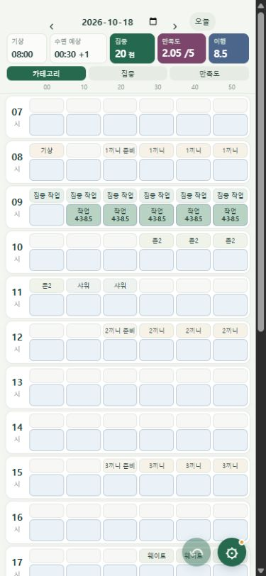

# ARA Daily OS

계획표와 기록표를 한 화면에 놓고, 실제 기록에 따라 남은 하루의 계획을 조정하는 시간관리 프로그램.

## 만든 이유

다른 계획 도구들은 내게 직관적이지 않거나, 계획을 짜고 관리하는 과정이 너무 번거로웠다. 솔직히 귀찮았다. 그래서 전자식 도구를 잘 쓰지 않고 종이에 계획표와 기록표를 작성하곤 했다.

그러다 AI를 활용해 개발을 조금씩 해보면서, 종이에 쓰던 계획표와 기록표를 내 방식대로 만들 수 있겠다는 생각이 들었다. 그렇게 시작한 프로젝트다.

가장 중요하게 생각한 건 한눈에 두 가지가 보이는 것이다. **무엇을 하려고 했는지, 그리고 실제로 하루를 어떻게 보냈는지.** 여기에 집중도와 하루의 만족도를 기록해서, 생산성뿐 아니라 내가 그 하루를 어떻게 느꼈는지도 확인하고 싶었다.

*테스트용 기록을 넣은 모바일 화면. 위쪽은 계획, 아래쪽은 실제 행동이다.*

## 직접 쓰면서 만족했던 부분

계획은 좋아하지만 나태한 편이다. 계획을 짜는 것도 귀찮은데, 한 번 틀어질 때마다 남은 하루를 다시 짜야 한다면 오래 쓰지 못할 것 같았다.

그래서 행동을 기록하거나 계획을 수정하면 이후 일정도 알아서 조정되도록 만들었다. 예를 들어 식사를 늦게 했다면, 뒤에 남은 대기 시간이나 조정 가능한 활동을 줄여 원래 정한 취침 시각에 맞추는 식이다. 이미 지나간 계획은 남겨 두고 이후 계획만 바꾼다.

계획에는 틀어졌을 때 조정할 여유가 필요하다고 생각한다. ARA에서는 그 여유를 어떻게 쓸지까지 자동으로 계산하게 했다. 버퍼가 부족해 조건을 맞출 수 없으면 부족한 시간을 표시한다. **직접 사용하면서 가장 만족도가 높았던 부분도 이 자동 조정이었다.**

기록과 수정도 최대한 간편하게 만들었다. 10분짜리 칸 6개가 한 시간을 이루고, 같은 시간의 계획과 실제 행동을 위아래로 비교할 수 있다. 화면은 한 번에 더 많은 시간을 볼 수 있도록 컴팩트하게 구성했다.

PC에서는 드래그로, 휴대폰에서는 손가락으로 칸을 쓸어 원하는 시간 범위를 선택한다. 계획한 활동을 실제로 한 시간대에 끌어다 놓거나, 빈칸을 선택해 카테고리를 고르면 기록할 수 있다. 블록을 옮기거나 양끝을 잡아 길이를 조절하는 방식으로 시간도 수정한다.

타이머는 시작해 놓고 정지를 잊는 일이 있었고, 휴대폰에서 숫자를 입력하면 키보드가 시간표를 가렸다. 그래서 지나간 시간을 선택해 기록하고, 집중도와 만족도도 키보드 없이 점수를 눌러 고르는 방식을 택했다.

## 하루 기록을 쌓아서 보고 싶었다

계획과 기록을 하루 단위로 보고 끝내기보다, 기록이 쌓이면 내 일상을 분석할 수 있었으면 했다.

그래서 노션에 날짜별 기록을 저장하고, 페이지 안에는 AI가 읽고 참고하기 쉬운 JSON 형태의 기록도 넣도록 만들었다. 이 자료를 바탕으로 AI와 생활 패턴을 분석하거나 일기를 작성하는 데 활용하고 싶다. 밤을 넘겨 생활할 때도 하루가 나뉘지 않도록 기록은 기상한 날짜를 기준으로 묶는다.

현재 구현한 것은 노션 기록 저장과 AI 참고용 데이터 내보내기까지다. 앱 안에서 AI가 자동으로 분석하거나 일기를 작성하는 기능은 아직 없다. 노션 전송 오류와 백그라운드 동작도 계속 확인하고 있다.

## 다른 사람도 쓸 수 있게 만들려면

직접 쓰다 보니 다른 사람들에게 배포하고, 나아가 상용화하는 것도 괜찮겠다는 생각이 들었다. 다만 지금은 내 생활에 맞춰 만든 부분이 많아서 다음 문제들을 풀어야 한다.

- **자동 조정의 개인화.** 사람마다 반드시 지켜야 할 시간과 줄여도 되는 활동이 다르다. 지금 내 식사·운동 루틴에 맞춰진 규칙을 각자 설정할 수 있어야 한다.
- **다른 앱과의 연동.** 사람들이 이미 쓰는 캘린더나 기록 도구가 다르다. 현재는 노션을 연결했고, 다음으로 Google Calendar의 고정 일정을 가져와 나머지 계획에 반영하려고 한다. Google Calendar 연동은 아직 예정 단계다.
- **요일별 생활 패턴.** 같은 사람도 주중과 주말, 요일마다 생활이 다르다. 그날에 맞는 기본 계획이 자연스럽게 나오도록 하려면 루틴을 어떻게 설정하고 적용할지 더 고민해야 한다.

목표는 내가 종이에 쓰던 표를 옮기는 데서 시작했지만, 이제는 **계획을 세우고 기록하는 수고를 줄이면서도, 계획이 틀어졌을 때 다시 이어갈 수 있는 도구**로 발전시키는 것이다.

## 코드와 개발 기록

Windows는 C# WinForms, Android는 Java와 WebView, 모바일 화면과 오프라인 일정 계산은 JavaScript를 사용한다. 휴대폰은 PC 없이도 기록과 계획 조정이 가능하고, 같은 Wi-Fi에서 PC와 연결해 동기화한다.

구현과 테스트 작성에는 AI의 도움을 받았다. 어떤 동작이 필요한지, 직접 써보니 무엇이 불편했는지와 수정 방향은 이 프로젝트를 사용하는 과정에서 정했다.

[문제를 발견하고 수정한 기록](docs/DEVELOPMENT.md) · [빌드·테스트 방법](docs/BUILD.md) · [검증 범위와 남은 한계](docs/VALIDATION.md) · [외부 라이브러리](THIRD_PARTY_NOTICES.md)
